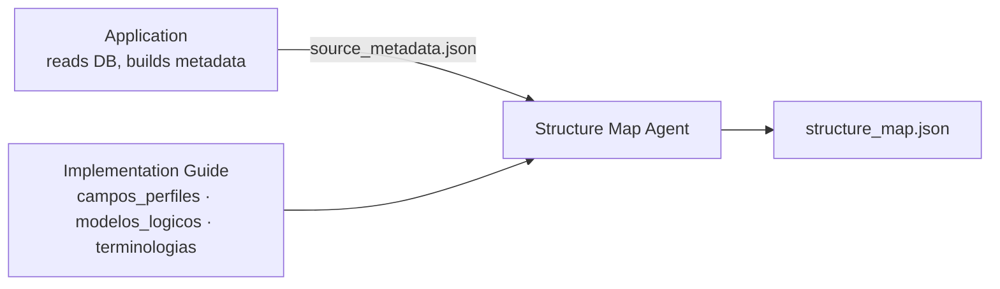

# Structure Map Agent

**Project:** Clinical Interoperability Copilot
**Role:** given the metadata of a source SQL database and the implementation guide, propose **structure maps** (source → FHIR), fully cited.
**Reference guide:** CL Core — Guía de Implementación cl core (`hl7.fhir.cl.clcore` 1.9.3, FHIR R4)
**Document version:** 3.0 · November 2026

---

## 1. The idea in one line

The application extracts the database metadata and hands it to the agent. The agent takes that metadata plus the implementation guide and proposes a **structure map**: for each source column, which FHIR element it should map to, with what type, terminology, and transformation — citing the exact source for every decision.

Split of responsibilities:

| The application does (deterministic) | The agent does (judgment) |
| --- | --- |
| Connect to the database (read-only) | Understand what each source column means |
| Query the catalog (`INFORMATION_SCHEMA`) | Match each column to a FHIR element in the guide |
| Extract tables, columns, SQL types, nullability | Turn declared FKs into FHIR references |
| Extract declared PK / FK | Match lookup values against FHIR value sets |
| Extract lookup-table contents + value samples | Flag gaps, ambiguities, and unmapped fields |
| Produce `source_metadata.json` (section 3) | Produce `structure_map.json` (section 4) |

There is no separate "database agent" to deploy: profiling is plumbing and lives in the app. The agent is a single reasoning step with two internal phases — understand the source, understand the guide — feeding one proposal.



---

## 2. What "structure map" means here

A readable, own mapping document in JSON: per source column, the FHIR destination (profile, element, type), the transformation, the terminology binding, a confidence, and a citation. It is **not** the formal FHIR `StructureMap` resource / FHIR Mapping Language.

That is deliberate for a first build: the JSON map is easy to produce, review, and feed to a pipeline. A later step can compile it into a formal `StructureMap` if an execution engine is wanted — see open item 1.

---

## 3. Input — `source_metadata.json` (from the application)

The contract the application must satisfy. Assumption: it carries schema **plus** value samples **plus** lookup contents (richest useful form). If only schema is provided, the agent still runs, with lower confidence on code-like columns.

```json
{
  "engine": "postgresql",
  "database": "scheduling",
  "tables": [
    {
      "name": "appointment",
      "comment": "Scheduled appointments",
      "primary_key": ["appointment_id"],
      "columns": [
        {
          "name": "start_ts",
          "sql_type": "TIMESTAMP",
          "nullable": false,
          "comment": "Appointment start date/time",
          "samples": ["2026-11-03T14:30:00", "2026-11-04T09:00:00"]
        },
        {
          "name": "status_id",
          "sql_type": "SMALLINT",
          "nullable": false,
          "comment": "Appointment status",
          "samples": [1, 2, 3]
        },
        {
          "name": "patient_id",
          "sql_type": "BIGINT",
          "nullable": false,
          "comment": "Patient reference",
          "samples": [10432, 10588]
        }
      ],
      "foreign_keys": [
        { "columns": ["patient_id"], "ref_table": "patient", "ref_columns": ["patient_id"] },
        { "columns": ["status_id"], "ref_table": "appointment_status", "ref_columns": ["id"] }
      ]
    }
  ],
  "lookups": [
    {
      "table": "appointment_status",
      "code_column": "id",
      "display_column": "label",
      "values": [
        { "code": 1, "display": "booked" },
        { "code": 2, "display": "arrived" },
        { "code": 3, "display": "cancelled" }
      ]
    }
  ]
}
```

What the app guarantees: types and nullability are facts (from the catalog); FKs are facts; lookup contents are facts. The agent treats all of this as ground truth and does **not** re-derive it.

---

## 4. Output — `structure_map.json`

The deliverable. One map per candidate entity (e.g. Appointment), against one target profile.

```json
{
  "entity": "Appointment",
  "target_profile": "appointment-bupa",
  "generated_at": "2026-11-06",
  "mappings": [
    {
      "source": { "table": "appointment", "column": "start_ts" },
      "target": { "profile": "appointment-bupa", "element": "Appointment.start", "type": "dateTime" },
      "transform": "direct",
      "required": true,
      "binding": null,
      "confidence": 0.95,
      "rationale": "source TIMESTAMP, NOT NULL; element name and type align",
      "citation": { "source": "campos_perfiles.csv", "ref": "appointment-bupa / Appointment.start" }
    },
    {
      "source": { "table": "appointment", "column": "status_id", "via_lookup": "appointment_status" },
      "target": { "profile": "appointment-bupa", "element": "Appointment.status", "type": "code" },
      "transform": "code-translation",
      "required": true,
      "binding": { "valueset": "appointment-status", "strength": "required" },
      "terminology_notes": "source labels booked/arrived/cancelled must map to FHIR appointment-status codes; 'arrived' has no direct code — needs a decision",
      "confidence": 0.8,
      "rationale": "lookup provides labels; target binding is required",
      "citation": { "source": "campos_perfiles.csv", "ref": "appointment-bupa / Appointment.status" }
    }
  ],
  "references": [
    {
      "source_fk": "appointment.patient_id -> patient.patient_id",
      "target": { "element": "Appointment.participant.actor", "type": "Reference", "target_profile": "patient-bupa" },
      "confidence": 0.9,
      "rationale": "declared FK to patient; participant.actor accepts patient-bupa",
      "citation": { "source": "campos_perfiles.csv", "ref": "appointment-bupa / Appointment.participant.actor" }
    }
  ],
  "unfilled_required": [
    {
      "element": "Appointment.participant.status",
      "reason": "no source column found",
      "action": "integration must supply a fixed or derived value"
    }
  ],
  "unmapped_source": [
    { "table": "appointment", "column": "legacy_flag", "reason": "no plausible FHIR destination; confirm with provider" }
  ],
  "ambiguities": [
    {
      "location": "appointment.reason_2",
      "question": "second reason, or sub-reason of reason_1?",
      "impact": "converge on one reasonCode or keep separate"
    }
  ]
}
```

The five output blocks are what a reviewer and the downstream pipeline actually use:
- `mappings` — the proposed column→element matches.
- `references` — FHIR `Reference`s derived from declared FKs (this is what lets the pipeline build a related-resource bundle).
- `unfilled_required` — required elements of the target profile with no source column: the real gaps an integration must close.
- `unmapped_source` — source columns with no destination: candidates to drop or escalate.
- `ambiguities` — decisions that need a human.

---

## 5. How it works (internal)

Two phases over the two inputs, then the proposal:

**Phase A — understand the source.** Read `source_metadata.json`. For each column, infer a `business_concept` from name + comment + samples (+ linked lookup). Group tables/columns into candidate entities (Appointment, Patient). Declared FKs are read as facts.

**Phase B — understand the guide.** The guide is loaded into SQLite (`campos_perfiles.csv`, `modelos_logicos.csv`, `terminologias.csv`) and a semantic index over any narrative pages. The agent queries it via tools — it never recalls field facts from memory.

**Phase C — propose the map.** For each source column:
1. Pick candidate target profiles from the entity (e.g. Appointment → `appointment-bupa`).
2. Search the guide for the FHIR element whose concept/type best matches the column (`consultar_campo`, `ver_modelo_logico`).
3. Set `transform`: `direct`, `code-translation` (code columns), `calculated`, or `fixed`.
4. If the target element has a binding, look it up (`buscar_binding`) and, for code columns, align the lookup labels against the value set; report mismatches in `terminology_notes`.
5. If the column is an FK, resolve it to a `Reference` whose `targetProfile` matches the referenced entity's profile.
6. Attach `confidence`, `rationale`, and `citation`.

Then compute the gap blocks: walk the target profile's required elements (`min ≥ 1`) and list any not covered (`unfilled_required`); list source columns no mapping used (`unmapped_source`).

---

## 6. Tools

The app already provided the source side, so the agent's tools mostly query the guide:

| Tool | Input | Returns |
| --- | --- | --- |
| `consultar_campo` | profile and/or element, or filter (required, must_support, binding) | rows from `campos`: `min/max`, type, binding, fixed value, logical model |
| `ver_modelo_logico` | logical model and/or field | business-language field definitions |
| `buscar_binding` | value set | terminology codes + display (`terminologias`) |
| `buscar_en_guia` | natural-language query | narrative sections with their section path |
| `listar_perfiles_por_dominio` | domain or resource | candidate profiles for an entity |

Phase A inference (business concept, entity grouping) and Phase C judgment (best-match element, transform choice) are the LLM's; everything factual comes from a tool.

---

## 7. Citation and confidence rules (system prompt, summary)

1. Every mapping, reference, and gap carries a `citation`: profile + element, logical model + field, or file + row.
2. Field facts (type, `min/max`, binding, fixed value) come from a tool, never from memory.
3. `confidence`: declared FK or exact type+concept match → 0.9+; good evidence from name/concept → 0.7–0.9; weak (name only) → < 0.7. Below ~0.6 the mapping goes to `ambiguities`, not `mappings`.
4. Distinguish **required** (`min ≥ 1`) from `mustSupport`, and always state binding strength (`required` / `extensible` / `preferred` / `example`).
5. If no FHIR destination is plausible → `unmapped_source`. If a required element has no source → `unfilled_required`. Never invent a column or a code to fill a gap.
6. Do not assume prestation codes or message examples the guide does not provide. Synthetic data only.

---

## 8. Minimal build order

What to build first to get an end-to-end result:

1. **Synthetic source DB** (SQLite): `appointment`, `patient`, `appointment_status`, declared PK/FK, synthetic rows. *(Prerequisite — we don't have a real source yet.)*
2. **App metadata extractor:** read the SQLite catalog → emit `source_metadata.json` (section 3).
3. **Guide store:** load the three CSVs into SQLite; expose the Phase B tools.
4. **Agent loop:** Claude + the tools; implement Phase A → B → C; emit `structure_map.json`.
5. **Review view:** render the five output blocks so a human can accept/correct each mapping.

Steps 2–4 are the solution; step 1 is a one-time fixture; step 5 is the demo surface.

---

## 9. Open items

1. **Formal StructureMap?** Keep the JSON map, or also compile to a FHIR `StructureMap`? JSON first; compile later only if an execution engine is needed.
2. **SQL engine of the source** (affects only the app's extractor, not the agent): SQLite or PostgreSQL recommended for the hackathon.
3. **Confidence rubric numbers:** the thresholds in section 7 are a starting point; tune against real output.
4. **Lookup detection thresholds** (app side): e.g. ≤ 50 rows and a code+label shape, or being an FK target.
5. **Demo scope:** one entity (Appointment) end to end, recommended, vs several.